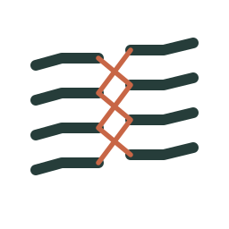

<div align="center">
    
    <h1>strata-kit</h1>
    <h3><em>Work in layers. Keep the thread.</em></h3>
    <p align="center">Trabaja por capas. No pierdas el hilo.</p>
</div>

<p align="center">
    <a href="https://github.com/team-tatters/strata-kit/stargazers"></a>
    <a href="https://github.com/team-tatters/strata-kit/blob/main/LICENSE"></a>
    
    
    
</p>

<p align="center">
    <a href="./README.md">English</a> ·
    <a href="./README.ko.md">한국어</a> ·
    <a href="./README.ja.md">日本語</a> ·
    <a href="./README.zh-CN.md">简体中文</a> ·
    <strong>Español</strong> ·
    <a href="./README.fr.md">Français</a>
</p>

strata-kit es una metodología para trabajar con agentes de programación con IA, empaquetada como kit. Su centro es el
registro: cada paso del trabajo se escribe en una carpeta de Markdown simple (el vault), cada tema conserva un único
documento que se actualiza en el sitio, y cada nueva sesión, agente o persona parte de esos mismos documentos. Eso es lo
que mantiene la coherencia del trabajo y le permite continuar entre sesiones, en lugar de empezar de cero en cada chat.

Funciona primero en Claude Code, y también en Codex y en cualquier otro agente que lea `AGENTS.md` y `SKILL.md`,
incluidos los agentes que ejecutas tú mismo con una clave de API.

Autor: n0roo · Licencia: [MIT](LICENSE)

## Por dónde empezar

| Quieres | Empieza por | Obtienes |
|---|---|---|
| Probarlo en un proyecto | [Inicio rápido](#inicio-rápido) | un vault, el plugin, la guía generada y una primera sesión |
| Entender la idea | [Qué ofrece](#qué-ofrece) | registros, especificaciones, tarjetas, skills y comprobaciones en una página |
| Elegir las reglas para tu stack | [Perfiles](#perfiles) | qué perfiles están probados en un proyecto real y cuáles son borradores |
| Consultar algo | [Documentación](#documentación) | tablas generadas de tarjetas, skills, comandos y perfiles |
| Conocer antes los límites | [Estado y límites](#estado-y-límites) | qué se ha medido y qué no |

## A quién va dirigido

Principalmente a desarrolladores que trabajan con un agente de programación, y sobre todo a ingenieros que llevan un
proyecto por su cuenta desde el plan hasta producción. Quienes planifican, diseñan u operan participan a través de los
mismos registros: documentos de planificación y especificaciones, decisiones y señales operativas. El kit todavía no
tiene un flujo de trabajo completo propio para esos roles, y aún no lo ha usado un equipo entero.

## Qué ofrece

- **Registros que se mantienen al día.** El vault guarda tres tipos de registro. El historial de trabajo (sesiones,
  tareas, evidencia de pruebas) solo crece por adición. Los documentos vivos describen cómo están las cosas ahora, uno
  por tema, se actualizan en el sitio y citan el historial de trabajo del que proceden. El índice (listas de decisiones,
  páginas de tema) se genera a partir de los otros dos y nunca se edita a mano. Las decisiones las escribe una CLI, un
  archivo por decisión, y solo cambian mediante un registro que las reemplaza. Cada sesión termina con un traspaso que
  indica qué queda abierto y qué lo bloquea.
- **Especificaciones que convergen.** Los documentos de planificación enlazan con especificaciones de la forma
  construida; las especificaciones son dueñas del código mediante `covers`; una puerta de cobertura informa del código
  cambiado sin dueño y de los planes implementados cuyo código se ha movido, con un grado por proyecto (`advisory` ·
  `default` · `block`) y una línea base para las carencias anteriores a la adopción.
- **Un método que se aprende sin agente.** Las convenciones (capas según el rol y nombres según el lenguaje, plan antes
  que especificación y especificación antes que código, decisiones y traspasos en archivos) están escritas para agentes,
  pero las personas pueden aprenderlas y usarlas de la misma forma.
- **Tarjetas de recomendación, no reglas en prosa.** Cada tarjeta tiene una afirmación, una fuerza (`must` · `should` ·
  `may`), cuándo se aplica y cuándo no, evidencia, contraejemplos y cómo verificarla. `must` no se negocia; `should` se
  puede desactivar dejando registrado el motivo. Ocho reglas base se aplican a todos los proyectos.
- **Skills que terminan en evidencia.** 16 skills principales (entrada y enrutamiento, asistente de guía, planificación,
  especificación, orden, tarea de construcción, verificación, revisión, decisión, actualización del conocimiento,
  traspaso, destilación, traducción, retrospectiva, señal operativa, seguridad), en seis idiomas, más paquetes opcionales
  (ideación, diseño). Cada skill dice cuándo usarla, qué evidencia la cierra y las excusas a las que recurre un agente
  cuando quiere saltarse un paso, con la respuesta a cada una. Seis roles (builder, worker, reviewer, supporter, operator,
  librarian) tienen definido lo que pueden y lo que no pueden hacer.
- **Hooks donde la aplicación los tiene, archivos simples donde no.** En Claude Code, los hooks y las tarjetas guían el
  flujo: una cabecera al iniciar la sesión muestra el proyecto, sus tarjetas `must` y la siguiente acción leída de los
  archivos, y un hook guarda el estado antes de que se compacte el contexto. Donde no hay hooks, la misma guía y las
  mismas skills son archivos `AGENTS.md` y `SKILL.md` simples, y el motor de la base de conocimiento es una herramienta
  de línea de comandos y un servidor MCP.
- **Comprobaciones graduadas en torno a los verificadores que ya tienes.** `kb enforce run` envuelve un verificador
  existente (un test de capas, dependency-cruiser, un lint) y registra cada ejecución, de modo que una familia de reglas
  puede ascender de grado cuando se conocen sus números.

## Documentación

Tablas de referencia generadas a partir de las fuentes: [tarjetas](docs/reference/cards.md) ·
[skills](docs/reference/skills.md) · [comandos](docs/reference/cli.md) · [perfiles](docs/reference/profiles.md)
(coreano: `docs/ko/reference/`). Las guías y las páginas de conceptos se están escribiendo. La referencia completa de la
metodología para agentes está en `core/docs/en/`.

## Estructura

```text
core/       reglas base (constitution/), tarjetas de recomendación, roles, esquemas, reglas de capas y nombres, docs (seis idiomas)
profiles/   paquetes por stack: selección de tarjetas, plantillas de layer-map y de verificadores, convenciones
skills/     procedimientos SKILL.md y registry.yaml (la tabla de enrutamiento que lee la skill de entrada); packs/
kb/         motor de la base de conocimiento: almacén, búsqueda, puertas, CLI de decisiones, servidor MCP
tools/      asistente, generadores de plugin y de bundle, validadores, doctor, métricas, ejecutor de evals
adapters/   entradas para el plugin de Claude Code y el bundle de Codex
i18n/       glosario y marcadores de traducción pendiente
```

## Perfiles

| Perfil | Estado |
|---|---|
| `core.generic` | active |
| `frontend.next-web` (Next.js / React) | active |
| `backend.kotlin-spring-cqrs` | active |
| `backend.go-service`, `backend.typescript-nest`, `cli.go`, `frontend.swiftui`, `service.rust` | draft |

*active* significa que el perfil se usa en un proyecto real y que un verificador de sus reglas de capas se ha ejecutado
allí y ha dejado un registro. Un perfil draft tiene sus documentos y reglas, pero sus verificadores aún no se han
probado en un proyecto.

## Inicio rápido

Requisitos: Python 3.11+, git, [uv](https://docs.astral.sh/uv/) para el servidor MCP, Claude Code para el plugin.

1. Coloca el kit y un vault. El vault es una carpeta de Markdown simple (se recomienda un repositorio git) donde viven
   los traspasos, las tareas, los documentos de conocimiento y las mediciones. `kb vault-init` crea uno a partir de las
   plantillas de `core/templates/vault/`; nunca sobrescribe un archivo.

   ```sh
   git clone https://github.com/team-tatters/strata-kit.git ~/workspace/strata-kit
   export STRATA_KIT=~/workspace/strata-kit
   cd "$STRATA_KIT" && uv sync
   python3 "$STRATA_KIT/kb" vault-init ~/workspace/vault --project my-app   # add --detached to keep Tier P in the vault
   export STRATA_VAULT=~/workspace/vault        # required: the engine never guesses a vault path
   ```

2. Construye e instala el plugin de Claude Code.

   ```sh
   python3 "$STRATA_KIT/tools/gen_claude_plugin.py" --locale en
   claude plugin marketplace add "$STRATA_KIT/dist/claude"
   claude plugin install strata-kit@strata-kit
   ```

   Registra el hook de la cabecera de inicio de sesión, un hook de instantánea previo a la compactación, las skills,
   seis agentes de rol y el servidor MCP de la base de conocimiento. Para Codex, `tools/gen_codex_bundle.py` escribe las
   skills y las instrucciones de los roles.

3. Genera la guía de un proyecto, o pide al agente "configura la guía de strata para este proyecto".

   ```sh
   python3 "$STRATA_KIT/tools/wizard.py" diagnose  <project>
   python3 "$STRATA_KIT/tools/wizard.py" recommend <project> --profile <id> --uses-vault yes
   python3 "$STRATA_KIT/tools/wizard.py" generate  <project> --apply
   python3 "$STRATA_KIT/tools/wizard.py" verify    <project>
   ```

4. Abre una sesión en el proyecto. La cabecera muestra el proyecto, sus tarjetas must y la siguiente acción leída de
   los archivos; di lo que quieres hacer y la skill de entrada lo enruta. Di "handoff" para cerrar.

Un proyecto puede mantener strata completamente fuera de un repositorio compartido (`detached`): la guía y los
registros viven entonces en el vault, y el repositorio solo recibe lo que ejecuta su CI.

## Estado y límites

- Cada skill principal tiene escenarios de presión que fallan sin la skill y pasan con ella (`skills/*/evals/`).
- La evidencia de que el método mejora el trabajo procede de una sola persona en un número reducido de proyectos. No
  se ha reproducido en otros lugares, y todavía no hay ninguna medición que muestre que supera otras formas de trabajar.
- El árbol de documentación de `core/docs/en/` y los archivos de reglas, las plantillas y los README de los
  verificadores están en inglés. Muchos comentarios del código de `kb` y algunos mensajes de la línea de comandos siguen
  en coreano.
- Quilt, el orquestador junto al que se construyó el kit, es un adaptador opcional (`--harness quilt`); su adaptador
  aún no está en este repositorio. Nada más depende de él.
- Los equipos nuevos deberían empezar con todas las comprobaciones en `advisory` y ascender una familia solo después de
  ver sus números.

## Contribuir

Las issues y las pull requests son bienvenidas; consulta [CONTRIBUTING.md](CONTRIBUTING.md). Informa de los problemas
de seguridad como se describe en [SECURITY.md](SECURITY.md).

El material de terceros figura en los archivos `NOTICE.md` situados junto a él (`skills/packs/*/`).
